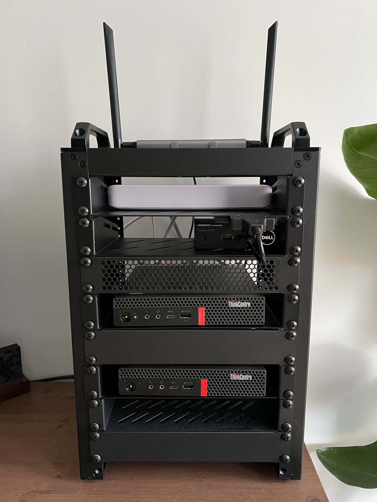

# Homelab

Home Assistant, n8n and Minecraft through Crafty Controller, running on a two-node
Talos Kubernetes cluster. All application endpoints are private.

ArgoCD deploys Kubernetes applications and platform services. Cilium handles
networking and firewall policies; Envoy Gateway and MetalLB provide private HTTPS
access. Prometheus, Grafana, Alertmanager, Loki and Alloy provide metrics, alerts
and logs. Terraform manages UniFi, Cloudflare and Crafty configuration; Ansible
manages Houston, the Terraform and backup host.

<p align="center">
  
</p>

## Local checks

Install [Aqua](https://aquaproj.github.io/) for the pinned tools in
[`aqua.yaml`](aqua.yaml). Install yamllint, SQLite and Docker separately; start
Docker for the integration tests. Run from the repository root:

```bash
aqua install
uv sync --locked
make validate
```

Validation covers formatting, Python types and lint, Terraform tests, rendered
Kubernetes manifests, integration tests, configuration security and secret
detection. It does not deploy resources or require cluster credentials.
`make scan-images` separately scans rendered container images from registries.
See [tests and VS Code setup](tests/README.md) for focused checks and formatting.

Use `make validate` explicitly: bare `make` runs ArgoCD bootstrap.

## Operations

| Task | Guide |
| --- | --- |
| Bootstrap or update the platform | [Talos patches, Cilium and ArgoCD](docs/security-runbook.md#bootstrap-and-platform-changes) |
| Access services or manage TLS, SSO and storage | [Platform operations](docs/security-runbook.md) |
| Use dashboards, alerts and logs | [Monitoring](system/monitoring/README.md) · [Logging](system/logging/README.md) |
| Back up or restore application data | [Application backups](docs/backups.md) |
| Recover cluster state or sealing keys | [Talos/etcd](docs/talos-etcd-recovery.md) · [SealedSecrets](docs/sealed-secrets-recovery.md) |
| Plan and apply Terraform changes | [Terraform and state recovery](terraform/README.md) |
| Configure Houston | [Ansible and host services](infra/ansible/README.md) |
| Manage LANs, DNS, firewall and WAN | [UniFi configuration](terraform/unifi/README.md) · [Network layout](infra/unifi/README.md) |
| Review security exceptions | [Exception register](docs/exception-register.md) |

## Repository layout

| Path | Contents |
| --- | --- |
| [`apps/`](apps/) | Home Assistant, Crafty Controller and n8n |
| [`system/`](system/) | Kubernetes platform manifests, Helm charts and bootstrap |
| [`talos/patches/`](talos/patches/) | Machine configuration patches |
| [`terraform/`](terraform/) | Cloudflare, UniFi and Crafty roots; reusable modules |
| [`infra/ansible/`](infra/ansible/) | Houston host configuration |
| [`infra/unifi/`](infra/unifi/) | Network architecture and WAN operations |
| [`tests/`](tests/) | Configuration and integration tests |
| [`docs/`](docs/) | Platform operations, backups and recovery |

Commit Kubernetes credentials as SealedSecrets. Plaintext credentials, device
backups, Terraform state and generated Talos configuration stay outside Git.
